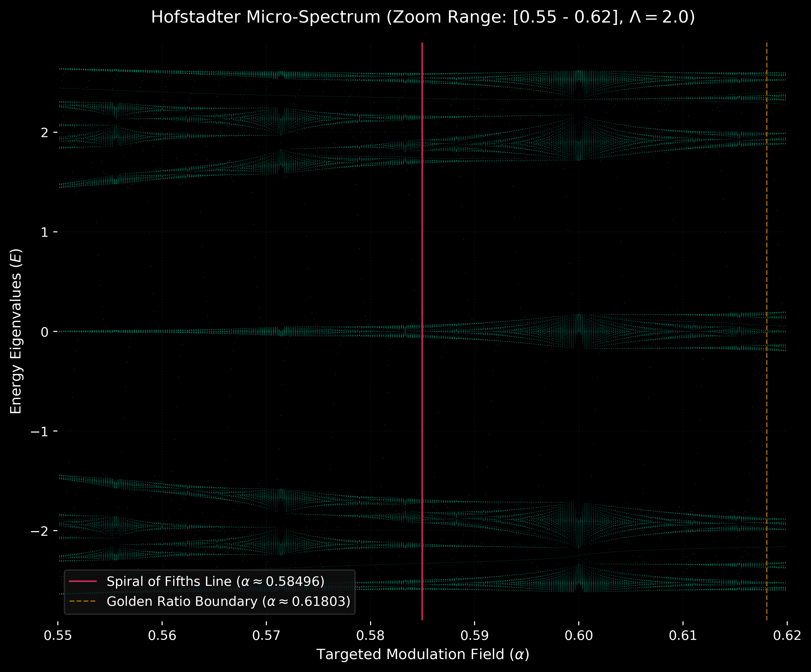

# Pentatonic Quantum Walks (P-QW)

An advanced quantum simulation framework uncoupling the physics of the untempered Spiral of Fifths into a standalone Continuous-Time Quantum Walk (CTQW) environment. By mapping irrational logarithmic frequency steps onto a 1D spatial lattice, the project simulates a native 1D Quasicrystal to explore the boundary lines between quantum wave-packet diffusion, fractal spectra, and localization.

## Core Architecture Deployed
* **Tight-Binding Lattice Setup:** Driven by a customizable cosine modulation potential where the native structural parameter is $\alpha = \log_2(1.5) \approx 0.58496$ (the pure, untempered perfect fifth).
* **Hamiltonian Model:** 
  $$H_{ii} = \Lambda \cos(2\pi \alpha i)$$
  $$H_{i,i\pm1} = -J$$

## Empirical Recent Discoveries

### 1. Localization Phase Transition Threshold
Through an automated systemic sweep of the potential energy amplitude $\Lambda \in [0.1, 4.0]$ against a fixed kinetic hopping bandwidth ($J = 1.0$), we successfully isolated the critical localization elbow. 
* **The Metallic Phase ($\Lambda < 2.0$):** The time-averaged Inverse Participation Ratio (IPR) flatlines tightly near $\sim 0.04$, indicating total ballistic/diffusive wave packet spreading across the spatial grid.
* **The Insulating Boundary ($\Lambda \ge 2.0$):** Exactly matching the theoretical Aubry-André self-duality threshold, transport grinds to a halt via destructive phase interference.
* *Diagnostic Asset saved at:* `docs/images/phase_transition_sweep.png`

### 2. Hofstadter Fractal Matrix Mapping
By promoting the frequency step parameter $\alpha$ to a dynamic sweep variable from $0 \to 1$, we mapped the global structural energy matrix landscape of our model.



* **The $\alpha = 0.60$ Pinch Point:** High-resolution microscopic parsing reveals an energy band collapse exactly at the rational fraction $3/5$, verifying structural convergence.
* **Topological Filtering:** The native Spiral of Fifths line cuts directly through major horizontal sub-gaps, acting as a directional filter that locks the walker into a discrete Cantor set of critical fractal states.
* *Global Matrix Asset saved at:* `docs/images/hofstadter_butterfly.png`

## Citation

If you use this simulation framework or the data structures in your research, please cite this repository and the corresponding preprint as follows:

```bibtex
@software{ballantine2026pentatonic,
  author       = {Ballantine, Russell},
  title        = {Pentatonic Quantum Walks (P-QW): A Quantum Simulation Framework for Incommensurate Lattices},
  year         = {2026},
  publisher    = {GitHub},
  journal      = {GitHub Repository},
  howpublished = {\url{https://github.com/russellballantine/pentatonic-quantum-walks}},
  note         = {ORCID: 0009-0003-5800-512X}
}
```
