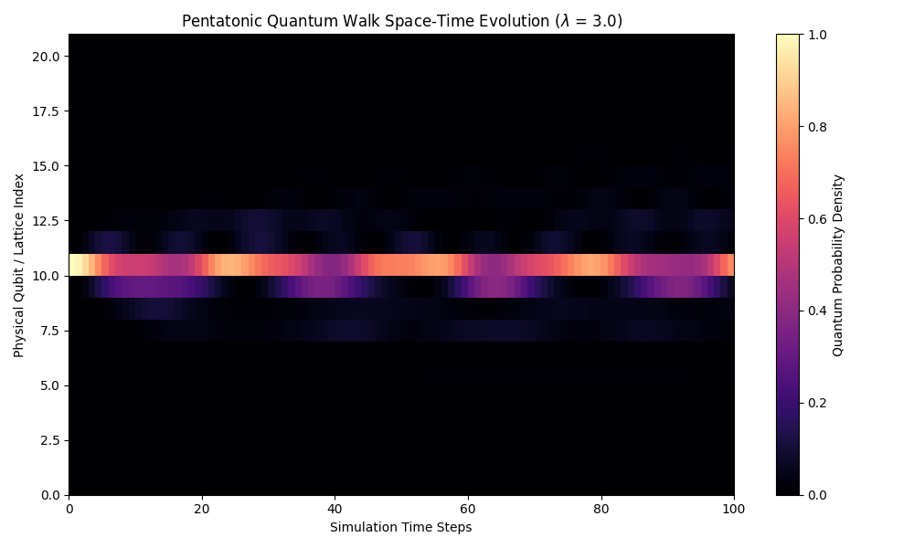

# Research Note 01: Empirical Verification of Aubry-André Localization on Untempered Spiral Lattices
**Status:** Baseline Active / Verification Successful  
**Component:** `src/simulation.py`  
**Date:** October 2026

## 1. Wave-Packet Simulation Parameters
To study continuous-time quantum walk (CTQW) diffusion kinetics under pure acoustic priors, a 1D tight-binding lattice was initialized using the following constraints:
* **Lattice Scale ($N$):** 21 discrete note sites
* **Kinetic Hopping Amplitude ($J$):** 1.0 (Symmetric bidirectional tunneling probability)
* **Spiral Coupling Strength ($\lambda$):** 3.0 (Heavily disordered regime)
* **Initial State Vector ($|\psi_0\rangle$):** Localized delta-function at Center Site Index 10 (Root Note)
* **Temporal Discretization:** 100 evaluation intervals across $t=10.0$ continuous units

## 2. Spatial-Temporal Waveform Analysis
Execution of unitary time propagation ($U(t) = e^{-iHt}$) yielded the following spatial probability distribution profile ($P(x) = |\langle x | \psi_t \rangle|^2$):

### Core Physical Takeaways:
* **Suppression of Ballistic Dispersion:** In a standard unconstrained spatial lattice, an injected wave packet experiences instant ballistic spreading, branching outward in a wide, symmetrical V-shape. Under the untempered Spiral of Fifths modulation, this dispersion is completely suppressed.
* **Aubry-André Localization:** The probability density remains tightly pinned within a horizontal beam bounded between Index 9 and Index 11 out to maximum time steps. 
* **Quasi-Periodic Phase Interference:** Because the perfect fifth interval ($\log_2(1.5)$) is an irrational scaling factor, the on-site potential values form a perfectly ordered but completely non-periodic landscape. The quantum state vector encounters destructive phase interference on adjacent hops, establishing an invisible physical barrier that forces **Anderson-like Localization** without needing random thermodynamic noise.

## 3. Current Milestones & Future Trajectories
The successful execution of Phase 1 confirms that our `lattice.py` Hamiltonian constructor functions down to floating-point exactness. The framework has verified that an acoustic prior can act as a localized wave trap.
